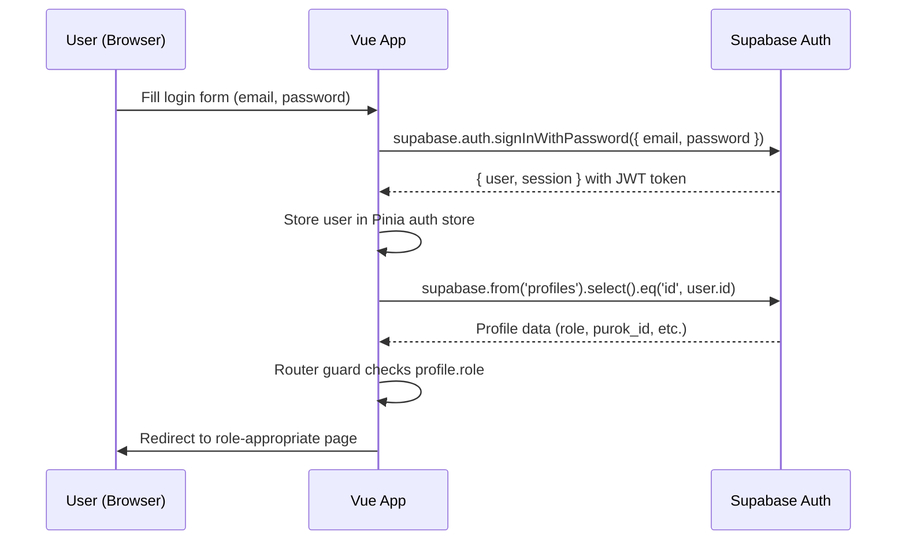
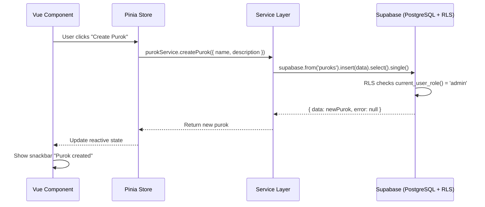
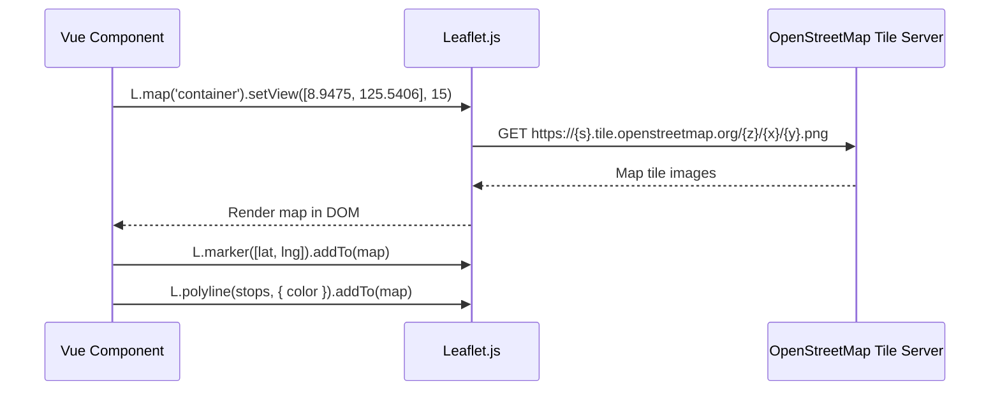
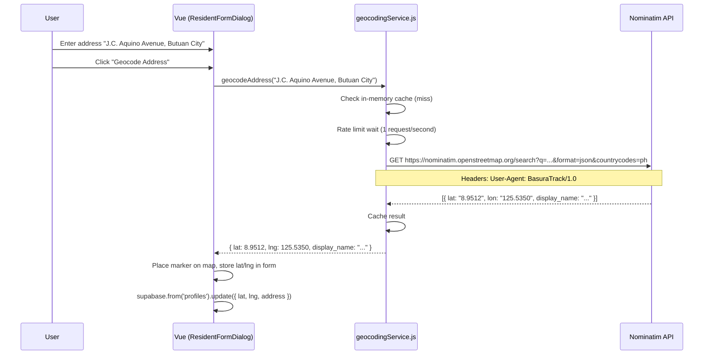
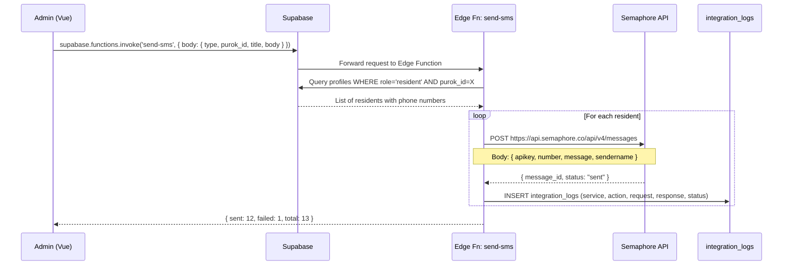
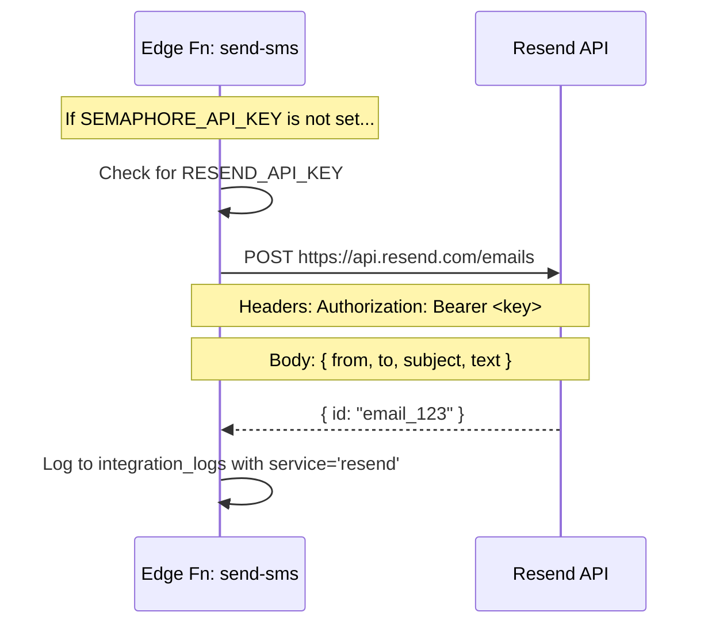
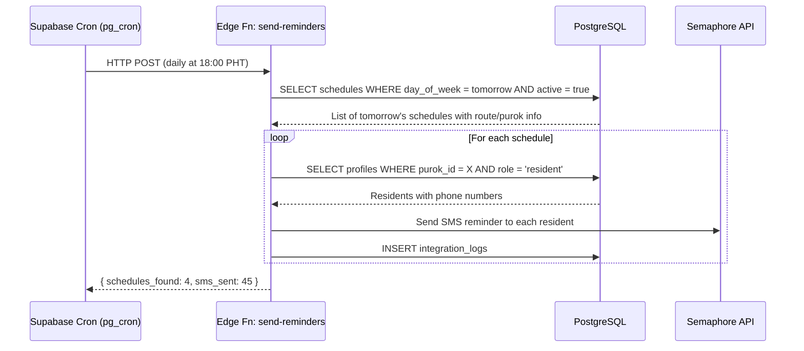
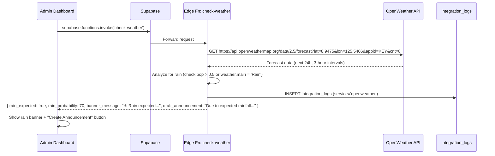
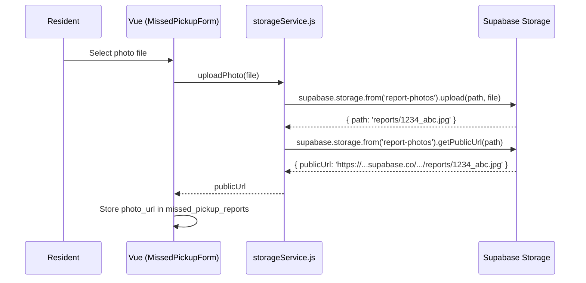
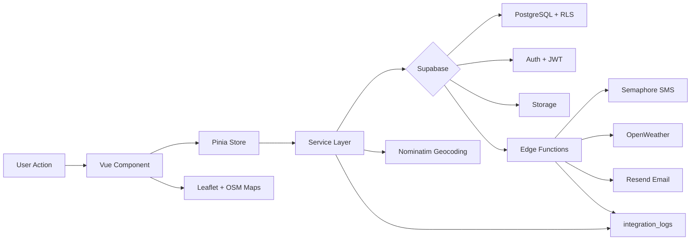

# API Flow Documentation

> Step-by-step explanation of every third-party integration in BasuraTrack.
> Use this document for your IT 109 presentation on System Integration and Architecture.

---

## Table of Contents

1. [Supabase Auth Flow](#1-supabase-auth-flow)
2. [Supabase Database (CRUD via supabase-js)](#2-supabase-database-crud)
3. [Map Display — Leaflet + OpenStreetMap](#3-map-display)
4. [Geocoding — Nominatim](#4-geocoding---nominatim)
5. [SMS — Semaphore API](#5-sms---semaphore-api)
6. [Email Fallback — Resend](#6-email-fallback---resend)
7. [Scheduled Reminders — Cron + Edge Function](#7-scheduled-reminders)
8. [Weather Check — OpenWeather API](#8-weather-check---openweather-api)
9. [Photo Upload — Supabase Storage](#9-photo-upload---supabase-storage)
10. [Integration Logs — Audit Trail](#10-integration-logs)

---

## 1. Supabase Auth Flow



**Key points:**
- JWT token is stored in localStorage by supabase-js automatically
- The `handle_new_user()` trigger auto-creates a profile row on signup
- `role` is passed via `raw_user_meta_data` during signup and stored in profiles
- Router guards in `src/router/index.js` check `meta.roles` against the user's role

**Files involved:**
- `src/stores/auth.js` — login, register, logout, profile fetch
- `src/router/index.js` — beforeEach guard
- `supabase/schema.sql` — `handle_new_user()` trigger

---

## 2. Supabase Database (CRUD)



**Architecture pattern:**
```
Component (UI) → Store (state) → Service (API) → Supabase (DB + RLS)
```

- Components NEVER call Supabase directly
- Services handle all `supabase.from()` calls with try/catch
- RLS policies enforce permissions at the database level (defense in depth)
- Every service uses `{ count: 'exact' }` for server-side pagination

**Files:** `src/services/*.js` (one per table)

---

## 3. Map Display



**Used in:**
- Route Map Editor (`views/Routes/RouteMapView.vue`) — click to add stops, drag to reorder
- Resident Form (`views/Residents/ResidentFormDialog.vue`) — pin placement
- Missed Pickup Form (`views/MissedPickups/MissedPickupFormDialog.vue`) — pin location
- Resident Home (`views/Home/ResidentHomeView.vue`) — route display

**No API key needed** — OpenStreetMap tiles are free and open.

---

## 4. Geocoding — Nominatim



**Nominatim usage policy compliance:**
- Custom `User-Agent` header: `BasuraTrack/1.0`
- Rate limited to max 1 request per second (enforced in `geocodingService.js`)
- Results cached in-memory to avoid duplicate requests
- Country filter: `countrycodes=ph` (Philippines only)
- Fallback: if geocoding fails, user can manually click the map to place a pin

**File:** `src/services/geocodingService.js`

---

## 5. SMS — Semaphore API



**Edge Function location:** `supabase/functions/send-sms/index.ts`

**Why an Edge Function?** The Semaphore API key is a secret and must never be exposed in frontend code. Edge Functions run server-side in Supabase's Deno runtime.

**Message format (reminder):**
```
BasuraTrack: Tomorrow, Monday 6:00 AM, collection for Biodegradable in Purok 1 - Libertad.
```

**Getting a Semaphore API key:**
1. Register at https://semaphore.co
2. Get free test credits
3. Copy your API key from the dashboard
4. Set as `SEMAPHORE_API_KEY` in Supabase Edge Function secrets

---

## 6. Email Fallback — Resend



**Fallback logic in `send-sms/index.ts`:**
1. If `SEMAPHORE_API_KEY` exists → use Semaphore SMS
2. Else if `RESEND_API_KEY` exists → use Resend email
3. Else → log as `pending` with error "No API key configured"

---

## 7. Scheduled Reminders



**Cron setup** (SQL in Supabase dashboard):
```sql
SELECT cron.schedule('send-daily-reminders', '0 10 * * *', ...);
```
`0 10 * * *` = 10:00 UTC = 18:00 PHT (day before collection)

**File:** `supabase/functions/send-reminders/index.ts`

---

## 8. Weather Check — OpenWeather API



**Response includes a `draft_announcement` string** that the admin can one-click post as an announcement.

**File:** `supabase/functions/check-weather/index.ts`

---

## 9. Photo Upload — Supabase Storage



**Storage bucket:** `report-photos` (created in schema.sql)
**RLS:** Authenticated users can upload; everyone can view.

**File:** `src/services/storageService.js`

---

## 10. Integration Logs

Every API call is logged to `integration_logs`:

| Column | Description |
|--------|-------------|
| `service` | `semaphore`, `nominatim`, `openweather`, `resend` |
| `action` | `send_sms`, `send_reminder`, `geocode`, `forecast`, `send_email` |
| `reference_id` | UUID of related record (schedule, announcement, etc.) |
| `request_payload` | JSONB of what was sent |
| `response_payload` | JSONB of what was received |
| `status` | `success`, `error`, or `pending` |
| `error` | Error message if failed |

**Admin can view all logs** at `/integrations` with:
- Filter by service (Semaphore, Nominatim, OpenWeather, Resend)
- Filter by status (success, error, pending)
- Click "View" to see full JSON request/response payloads
- Color-coded status chips for quick visual scanning

This page is designed for your **presentation demo** — you can show the exact request/response of every API call made by the system.

---

## Data Flow Summary



Every arrow represents a traceable API call that can be demoed on the Integrations page.
